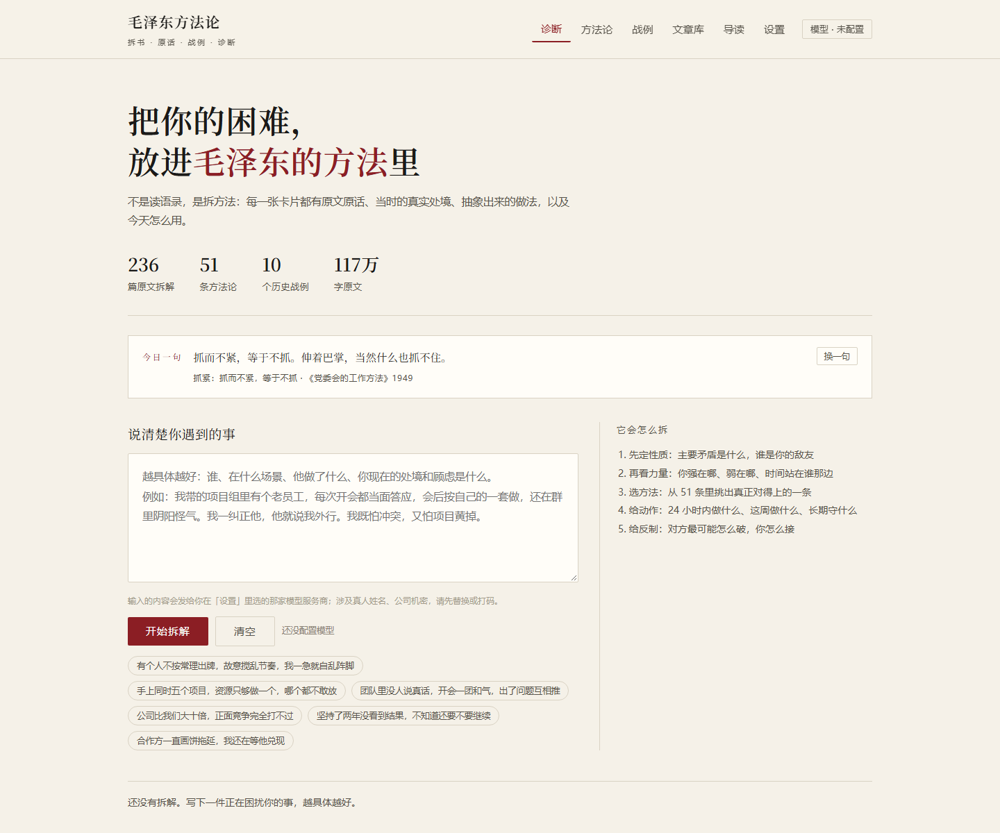
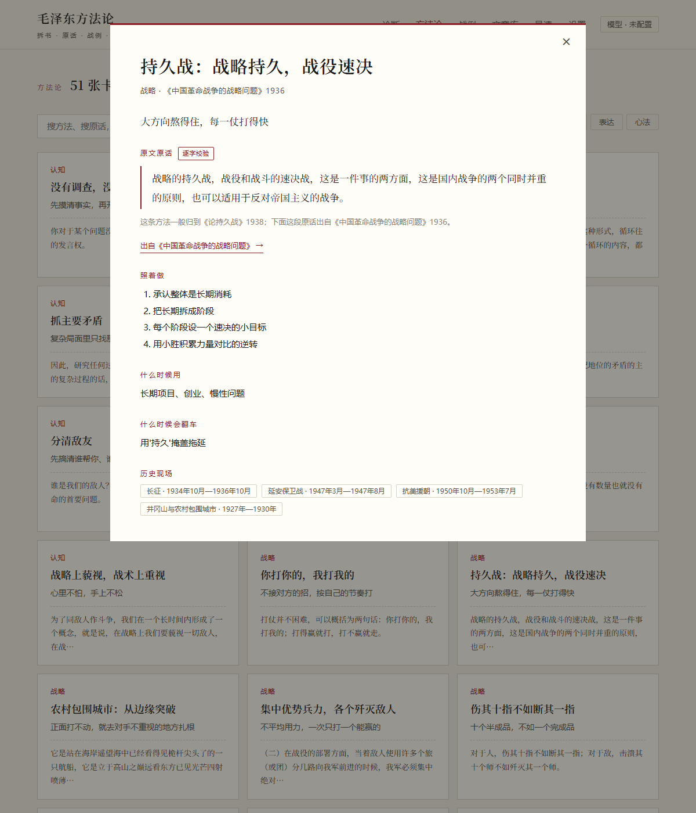
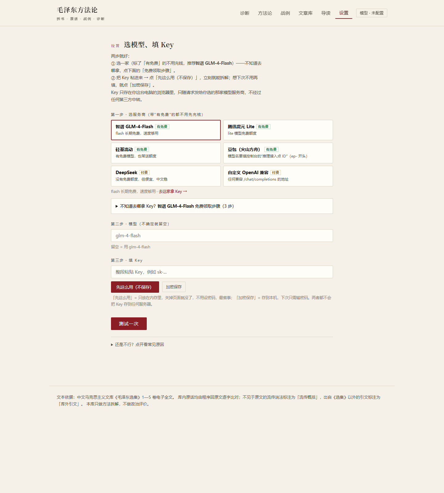

# 毛泽东方法论 · 拆书知识库

把《毛泽东选集》1—5 卷拆成「原话 → 历史史实 → 可迁移方法」，再让模型用它来拆你遇到的现实难题。

一个 4.2MB 的单文件 HTML，双击就能用；不依赖服务器、不上传数据。



## 里面有什么

| 模块 | 数量 |
|---|---|
| 文章库 | 236 篇（1—5 卷正式选文，含全文） |
| 方法论卡 | 51 张，分认知 / 战略 / 执行 / 统御 / 表达 / 心法 |
| 战例 | 10 个（四渡赤水、长征、延安、辽沈、淮海、平津、抗美援朝、重庆谈判、井冈山、皖南事变） |
| 原话 | 1283 条文章引文，1,279 条逐字命中、4 条仅标点差异，0 条未命中 |
| 每日案例 | 102 个（51 条方法 × 职场 / 生活各一） |

原文 147 万字，其中正式选文 116.7 万字。



## 直接使用

1. 下载 `毛泽东方法论.html`
2. 双击打开（Chrome / Edge / 任意现代浏览器）
3. 浏览、搜索、看方法论和战例——这些不需要联网，也不需要 Key

想让它**帮你拆解遇到的困难**，才需要接一个模型：



1. 右上角「设置」
2. 第一步选一家带「有免费」的服务商（推荐 **智谱 GLM-4-Flash**，长期免费）
3. 不知道该去哪拿 Key，点开页面里的「免费领取步骤」，三步照做
4. 把 Key 粘进第三步 →「先这么用（不保存）」（关页面即失效）或「加密保存」（存本机，AES-GCM 加密）
5. 点「测试一次」，看到「● 通了」就可以回「诊断」页写困难了

Key 只存在你自己浏览器的 localStorage 里，不上传任何服务器。

## 诊断会输出什么

写清楚你的处境 →「开始拆解」，会看到：

- 五个阶段进度：读懂处境 → 核对方法卡 → 排出动作 → 预演反制 → 收成一句话
- 一句话结论
- 主要矛盾（大字标出）
- 敌友 / 力量 / 节奏三行
- 选中的方法：原话 + 出处 + 为什么对得上
- 时间线：24 小时内做什么、这周做什么、长期守什么
- 对方最可能的反制，以及你怎么接
- 别做什么

不想花额度看排版效果：地址后面加 `?demo=1`。

## 本地服务（可选）

```bash
npm start          # 或双击 启动.bat
# http://localhost:8099
```

| 接口 | 用途 |
|---|---|
| `POST /api/analyze` | 服务端直接拆解（Key 放服务器） |
| `POST /api/proxy` | 网页跨域转发 |
| `GET /api/daily` | 每日一则 |
| `GET/POST /wechat` | 微信公众号被动回复 |

只起服务、不打开浏览器：双击 `启动服务.bat`。

## 目录

```
mao-knowledge/
├─ 毛泽东方法论.html        # 单文件版（构建产物，已提交）
├─ 启动.bat / 启动服务.bat
├─ site/                    # 开发版
│  ├─ index.html / v2.css / v2.js
│  ├─ kb.js                 # 4.3MB 知识库数据
│  └─ server.mjs            # 静态 + 诊断 + 代理 + 每日 + 公众号
├─ corpus/                  # 语料、方法论、每日案例、概念
├─ analysis/                # 236 篇逐篇拆解
├─ _src/                    # 抓取、生成、打包脚本
└─ miniprogram/             # 微信小程序（已放弃，留档）
```

## 自己重新生成

```bash
pip install requests
python _src/fetch.py                          # 抓原文（需能访问 marxists.org，可用 HTTP_PROXY）
python _src/extract.py                        # HTML → 结构化
python _src/analyze_articles.py --workers 6   # 逐篇拆书（需 DEEPSEEK_API_KEY，可断点续跑）
python _src/build_methods.py                  # 方法论卡 + 原话逐字校验
python _src/build_daily.py                    # 每日案例
python _src/build_site.py                     # 生成 site/kb.js
node _src/build_single.mjs                    # 打包单文件
```

**改了 `site/v2.js` 或 `v2.css` 必须重跑最后一步**，单文件才会更新。

Key 用环境变量 `DEEPSEEK_API_KEY`，或写在 `_src/.env.local`（该文件已在 `.gitignore` 里）。

## 数据与可信度

- 文本来源：中文马克思主义文库《毛泽东选集》1—5 卷电子全文（与人民出版社版同源）
- 原话由模型抽取后，程序回原文做**逐字比对**，不匹配自动丢弃
- 不见于原文但流传很广的说法（如「存人失地」）单独标注为**流传概括**
- 战例引文逐条标注出处；出自《选集》以外的，标注为**库外引文**并给出文献名
- 只做方法拆解，不做政治评价

## 版权与免责

原文版权归原作者及出版方所有，本项目仅用于学习与研究，见 [NOTICE.md](NOTICE.md)。如权利人认为收录不当，请开 issue，我会删除。

## License

代码部分 MIT，见 [LICENSE](LICENSE)。
